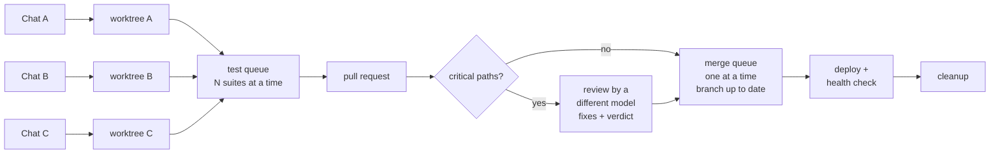

# skills

**Run many AI coding chats in parallel on the same repo without one breaking another: each gets its own worktree, then pull request, tests, cross-model review and merge, end to end.**

Four skills for running several AI coding chats on one repo — deliver changes in parallel, and choose per chat which model helps and which reviews (Claude Code, Codex, Gemini).

[](https://github.com/mestrecs/skills/stargazers)
[](https://skills.sh/mestrecs/skills)
[](LICENSE)




*Real run, shortened: two chats, one repo, same moment. The late chat waits for the lock, re-tests on the new base, then merges.*

## Quick start

```bash
npx skills add mestrecs/skills        # installer needs Node 22.20+; on Node 20, use the plugin or copy route below
# or one skill: npx skills add mestrecs/skills --skill codex-gemini-subagents-for-claude-code
# open your agent (Claude Code, Codex, Gemini CLI) in your repo
# ask it to work; on first use the skill sets itself up (writes .parallel-pr.json)
```



## Skills

### Ship in parallel

| Skill | Use when | What you get |
| --- | --- | --- |
| [`parallel-worktree-pr-merge-end-to-end`](skills/parallel-worktree-pr-merge-end-to-end/SKILL.md) | Several chats or agents edit one repo at once; changes collide or overwrite each other; you want a PR merged safely with a second model reviewing it | One worktree per chat, a shared test queue, PR creation, cross-model review, a one-at-a-time merge gate, deploy check, and cleanup. |

### Choose who helps and who reviews

| Skill | Use when | What you get |
| --- | --- | --- |
| [`codex-gemini-subagents-for-claude-code`](skills/codex-gemini-subagents-for-claude-code/SKILL.md) | You want Claude Code to send subagent work to Codex CLI or Gemini / Antigravity CLI per chat instead of spending Claude quota | Per-chat helper switch, sandboxed Codex and Gemini runners, a hook that blocks unintended Claude subagents, verified quota fallback, and an exception log. |
| [`cross-model-code-review-codex-gemini-claude`](skills/cross-model-code-review-codex-gemini-claude/SKILL.md) | You want PRs or branch diffs reviewed by a different model (Codex, Gemini/agy, or fresh Claude) per chat without wasting quota or falling back on slowness | Per-chat reviewer choice, fallback only when missing, logged out, or at quota limit, concurrency caps, safe fix commits, and single-commit verdicts. |
| [`claude-code-subagent-model-routing`](skills/claude-code-subagent-model-routing/SKILL.md) | Your Claude Code subagents run on Claude and you want hook-enforced Haiku/Sonnet/Opus cost routing instead of rules the chat forgets | A hook that routes search tasks to Haiku, reserves Sonnet/Opus for judgment, stops retry loops after three failures, and offers a lean helper. |



*Guard and fallback replay: a chat set to Codex blocks a Claude subagent, hits the Codex quota ceiling, then falls back with a verified marker and audit entry.*

### How they fit together

- [`parallel-worktree-pr-merge-end-to-end`](skills/parallel-worktree-pr-merge-end-to-end/SKILL.md) takes each chat from an isolated worktree through tests, PR, merge gate, deploy, and cleanup.
- [`codex-gemini-subagents-for-claude-code`](skills/codex-gemini-subagents-for-claude-code/SKILL.md) chooses per chat whether helper tasks run on Codex, Gemini/Antigravity, or Claude.
- [`cross-model-code-review-codex-gemini-claude`](skills/cross-model-code-review-codex-gemini-claude/SKILL.md) chooses per chat which engine reviews the diff, falling back only at a verified quota limit.
- [`claude-code-subagent-model-routing`](skills/claude-code-subagent-model-routing/SKILL.md) picks the Claude model and effort whenever a subagent runs on Claude.

## Install

Pick one route. Installing the same skill twice (for example plugin and copied files) makes your agent see it twice.

<details>
<summary><b>npx skills</b> (any agent; the installer needs Node 22.20 or newer, the skill itself runs on Node 20+)</summary>

```bash
npx skills add mestrecs/skills
```

One skill only, or one agent only:

```bash
npx skills add mestrecs/skills --skill parallel-worktree-pr-merge-end-to-end
npx skills add mestrecs/skills --skill codex-gemini-subagents-for-claude-code # or cross-model-code-review-codex-gemini-claude, claude-code-subagent-model-routing
npx skills add mestrecs/skills -a claude-code
```

List what is inside with `--list`, install for every project with `-g`, update later with `npx skills update`. This copies files; it does not update by itself.
</details>

<details>
<summary><b>Claude Code, plugin marketplace</b> (updates itself)</summary>

```bash
claude plugin marketplace add mestrecs/skills
claude plugin install parallel-worktree-pr-merge-end-to-end@mestrecs-agent-skills
```

On Claude Code 2.1.292 or newer, one step also works:

```bash
claude plugin install parallel-worktree-pr-merge-end-to-end --marketplace mestrecs/skills
```

Inside a session, the same thing is `/plugin marketplace add mestrecs/skills` and `/plugin install parallel-worktree-pr-merge-end-to-end@mestrecs-agent-skills`. If the add step fails with `Permission denied (publickey)`, tell git to use HTTPS: `git config --global url."https://github.com/".insteadOf git@github.com:`.
</details>

<details>
<summary><b>Claude Code, manual copy</b></summary>

Copy `skills/parallel-worktree-pr-merge-end-to-end/` into `~/.claude/skills/` (all projects) or `<your-repo>/.claude/skills/` (one project).
</details>

<details>
<summary><b>Codex CLI</b></summary>

Copy `skills/parallel-worktree-pr-merge-end-to-end/` into `~/.agents/skills/` (all projects) or `<your-repo>/.agents/skills/` (one project). Or let `npx skills` do it:

```bash
npx skills add mestrecs/skills -a codex
```

Older Codex versions read `~/.codex/skills/` instead; copy there if the skill does not show up. A Codex plugin package is not published yet.
</details>

<details>
<summary><b>Gemini CLI</b></summary>

```bash
gemini skills install https://github.com/mestrecs/skills.git --path skills/parallel-worktree-pr-merge-end-to-end
```

Add `--scope workspace` to keep it to one project, `--consent` to skip the confirmation. Manual route: copy the folder to `~/.gemini/skills/` or `<your-repo>/.gemini/skills/`.

Since 18 June 2026 Google serves Gemini CLI only to API-key and enterprise accounts; consumer sign-ins moved to the Antigravity CLI. If you use that one, the skill works the same through `npx skills add mestrecs/skills`; Gemini is then just one of the optional reviewers you leave out.
</details>

<details>
<summary><b>Cursor</b></summary>

```bash
npx skills add mestrecs/skills -a cursor
```

Or copy the folder to `<your-repo>/.cursor/skills/` or `~/.cursor/skills/`. Cursor also reads `.claude/skills/` and `.agents/skills/`. Invoke it with `/parallel-worktree-pr-merge-end-to-end`.
</details>

On first use the skill finds no `.parallel-pr.json`, inspects your setup, asks a few questions (who reviews, where it goes live, how many chats at once) and writes the file for you to commit.

## Why this exists

- **Two chats, one folder.** One switched branches while the other was mid-edit and committed its half-written files onto the wrong branch. Now every chat has its own worktree and nobody touches the shared checkout.
- **Green against an old base.** Two PRs, each green, merged back to back and broke the base, because each had only been tested against the code from before the other. Now merges go one at a time and the branch must contain the latest base before it merges.
- **Review that was never read.** A reviewer approved its own model's blind spots, and a "small fix" after approval brought the bug back. Now critical changes get a verdict from a different model, written to a file that is valid for exactly one commit.
- **A text rule the chat kept skipping.** A chat told to use Codex for helpers kept starting Claude subagents through gaps in a rule written in text, spending the quota meant for something else. Now a hook enforces the per-chat choice and every exception is logged.
- **Same-model blind spots.** A review by the same model that wrote the change missed what a different model caught. Now each chat chooses its reviewer (Codex, Gemini, or a fresh Claude session) and falls back only at a verified quota ceiling.

The rules and the reason behind each one are in [`method.md`](skills/parallel-worktree-pr-merge-end-to-end/references/method.md).

## How it compares

- **superpowers `using-git-worktrees`** gives one agent an isolated worktree. It stops there. This skill starts at the worktree and goes on to tests, PR, review, merge, deploy and cleanup, and it coordinates several chats at once.
- **Claude Code `/ship` and Claude Ship** open a PR from your branch and follow it, for one change at a time, and Claude Ship needs a team plan. Neither merges for you. This skill merges, behind a gate, and works with Codex and Gemini CLI as well.

## Requirements

- git, with a remote called `origin` (for worktree and PR workflows)
- [GitHub CLI](https://cli.github.com/) (`gh`), logged in with `gh auth login` (for PR creation, merge, and `--pr` reviews)
- [Node.js](https://nodejs.org/) 20 or newer for the scripts (no npm install; CI runs Node 20 and 22)
- Claude Code (`claude`) for the subagent guard and model-routing hooks
- At least one of [Codex CLI](https://developers.openai.com/codex/cli), [Gemini CLI](https://geminicli.com/docs/), or Antigravity CLI (`agy`) for the non-Claude helper and reviewer engines (and as optional cross-model reviewers)

## FAQ

**Does it work without GitHub?** No. The pull request, the merge and the gate go through `gh`. A GitLab or Gitea port would be a welcome contribution.

**Which model reviews?** You choose the order in `.parallel-pr.json`; the next one is used when the first is missing, logged out or over its quota cap. Codex and Gemini are the usual first picks because they differ from the model that wrote the code.

**Does it run on Windows?** Yes. Scripts are plain Node, dependencies are linked with a junction instead of a symlink, and CI runs the tests on Windows, macOS and Linux.

**What if two chats finish at the same moment?** They queue on a per-repo merge lock. The first merges; the second then merges the new base into its branch, re-runs the tests only because the base moved, and merges. If it conflicts, it stops with exit code 5 and tells the chat to resolve it in its worktree.

**What if I only use Claude?** Set `review.engines` to `["claude"]`. The reviewer is then a fresh Claude session (Sonnet, medium effort), never the chat that wrote the change. Weaker than a second vendor, but still a second pair of eyes, and nothing else changes.

**Can a chat still start Claude when the guard is on?** Only with a recent ceiling proof (`CLAUDE-ONLY: ceiling`) or a configured Claude-only tool (`CLAUDE-ONLY: tool <name>`), and both are logged to the audit file. A hook cannot stop indirect launches such as a program that runs Claude inside it — see [`guard-hook.md`](skills/codex-gemini-subagents-for-claude-code/references/guard-hook.md).

**Do I need all four skills?** No. Each skill works alone; install only what you want with `--skill <name>`.

## Contributing

Issues and pull requests are welcome. See [CONTRIBUTING.md](CONTRIBUTING.md); the scripts are tested with `node --test` and CI must stay green.

## Star history

[](https://star-history.com/#mestrecs/skills&Date)

## License

MIT, see [LICENSE](LICENSE).
